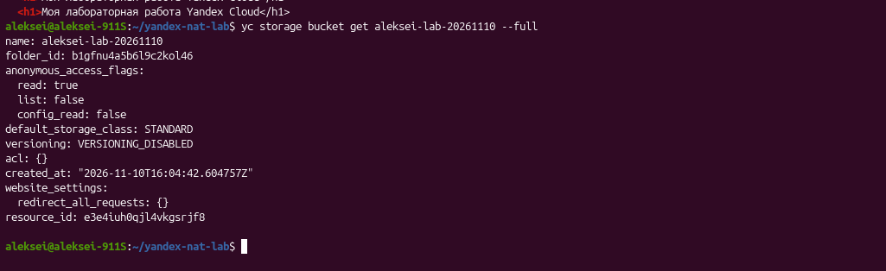
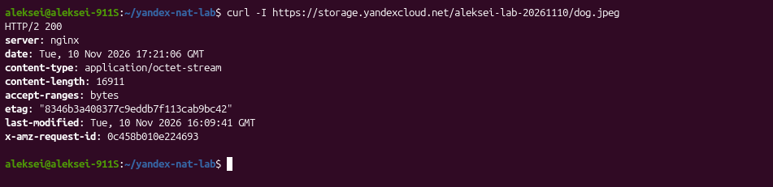
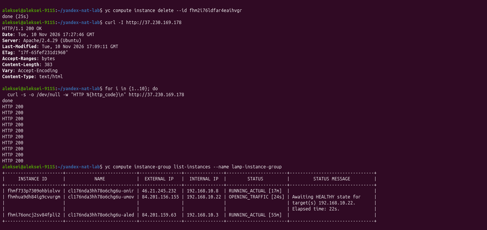
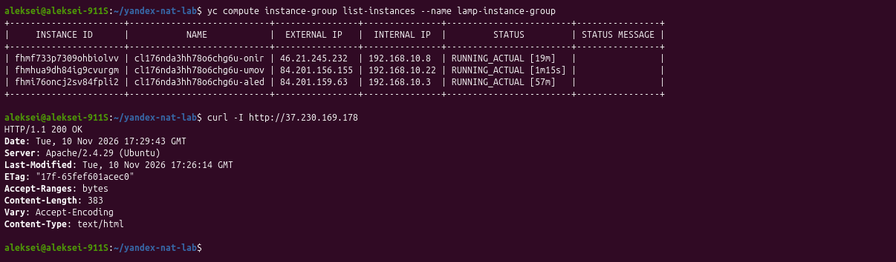

# Домашнее задание к занятию «Вычислительные мощности. Балансировщики нагрузки»

### Задание 1. Yandex Cloud

Рабочая папка

Действие: создать рабочую папку и перейти в неё.

Команды: mkdir -p ~/yandex-nat-lab cd ~/yandex-nat-lab

1. ПРОВЕРКА YANDEX CLOUD CLI

Действие: проверить установленную версию Yandex Cloud CLI.

Команда: yc –version

Действие: посмотреть текущую конфигурацию CLI.

Команда: yc config list

Действие: посмотреть Cloud ID и Folder ID текущего профиля.

Команды: yc config get cloud-id yc config get folder-id

2. ПРОВЕРКА СЕТИ И ПОДСЕТИ

Действие: вывести список виртуальных облачных сетей.

Команда: yc vpc network list

Действие: вывести список подсетей.

Команда: yc vpc subnet list

Действие: посмотреть параметры созданной публичной подсети.

Команда: yc vpc subnet get –id e9b6957ptbets9p29qqh

3. OBJECT STORAGE

Действие: посмотреть список бакетов Object Storage.

Команда: yc storage bucket list

Действие: посмотреть подробные параметры созданного бакета и настройки
доступа.

Команда: yc storage bucket get aleksei-lab-20261110 –full

Действие: проверить доступность загруженного изображения в интернете.
Ожидаемый ответ — HTTP 200.

Команда: curl -I
https://storage.yandexcloud.net/aleksei-lab-20261110/dog.jpeg

Публичная ссылка на изображение:
https://storage.yandexcloud.net/aleksei-lab-20261110/dog.jpeg

4. INSTANCE GROUP

Действие: посмотреть параметры Instance Group, её размер, настройки
проверки здоровья и целевую группу балансировщика.

Команда: yc compute instance-group get –id cl176nda3hh78o6chg6u

Действие: вывести список виртуальных машин, входящих в Instance Group, с
их IP-адресами и состояниями.

Команда: yc compute instance-group list-instances –name
lamp-instance-group

5. ПРОВЕРКА ВЕБ-СЕРВЕРОВ НА ВИРТУАЛЬНЫХ МАШИНАХ

Действие: проверить HTTP-ответ первого веб-сервера напрямую по внешнему
IP.

Команда: curl -I http://46.21.245.232

Действие: проверить HTTP-ответ второго веб-сервера напрямую по внешнему
IP.

Команда: curl -I http://51.250.72.197

Действие: проверить HTTP-ответ третьего веб-сервера напрямую по внешнему
IP.

Команда: curl -I http://84.201.159.63

6. NETWORK LOAD BALANCER

Действие: посмотреть параметры созданного Network Load Balancer, его
состояние, слушатель и IP-адрес.

Команда: yc load-balancer network-load-balancer get –id
enpouvo8d7c6hjhef4c8

Действие: посмотреть целевую группу и адреса виртуальных машин,
добавленных в неё.

Команда: yc load-balancer target-group get –id enpkeih93d3q86sg8ngj

Действие: проверить доступность сайта через публичный IP балансировщика.
Ожидаемый ответ — HTTP 200.

Команда: curl -I http://37.230.169.178

Действие: выполнить десять запросов к сайту через балансировщик и
вывести заголовок страницы.

Команда: for i in {1..10}; do curl -s http://37.230.169.178 | grep “
” done

Действие: выполнить десять запросов и вывести HTTP-код каждого ответа.

Команда: for i in {1..10}; do curl -s -o /dev/null -w “HTTP
%{http_code}\n” http://37.230.169.178 done

7. ПРОВЕРКА ОТКАЗОУСТОЙЧИВОСТИ

Действие: удалить одну виртуальную машину из Instance Group для имитации
отказа. В этой работе была удалена ВМ с ID fhm2i76ldfar4eaihvgr.

Команда: yc compute instance delete –id fhm2i76ldfar4eaihvgr

Действие: проверить, продолжает ли сайт отвечать через Network Load
Balancer после удаления виртуальной машины.

Команда: curl -I http://37.230.169.178

Действие: выполнить десять запросов после удаления ВМ и проверить
HTTP-коды ответов.

Команда: for i in {1..10}; do curl -s -o /dev/null -w “HTTP
%{http_code}\n” http://37.230.169.178 done

Действие: проверить, что Instance Group автоматически создала замену
удалённой виртуальной машине.

Команда: yc compute instance-group list-instances –name
lamp-instance-group

Действие: проверить итоговое состояние Instance Group и количество
работающих виртуальных машин.

Команда: yc compute instance-group get –id cl176nda3hh78o6chg6u

Действие: выполнить заключительную проверку доступности сайта через
балансировщик.

Команда: curl -I http://37.230.169.178

8. ОСНОВНЫЕ ИДЕНТИФИКАТОРЫ РЕСУРСОВ

Рабочая папка: ~/yandex-nat-lab

VPC: homework-vpc

Подсеть: public 192.168.10.0/24

Object Storage bucket: aleksei-lab-20261110

Объект в бакете: dog.jpeg

Instance Group: lamp-instance-group ID: cl176nda3hh78o6chg6u

Target Group: lamp-instance-group-targets ID: enpkeih93d3q86sg8ngj

Network Load Balancer: lamp-network-balancer ID: enpouvo8d7c6hjhef4c8
Публичный IP: 37.230.169.178

Количество виртуальных машин по настройке группы: 3

Образ виртуальной машины: fd827b91d99psvq5fjit