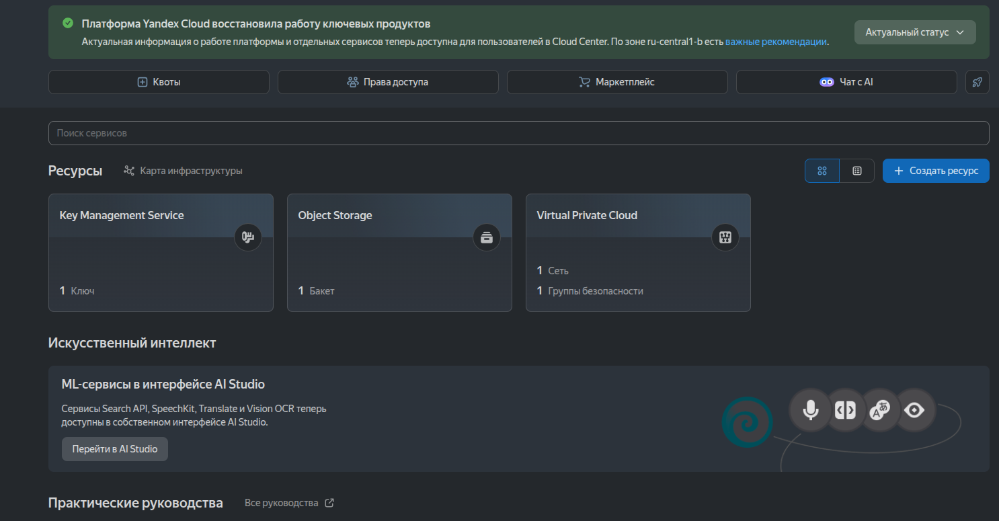
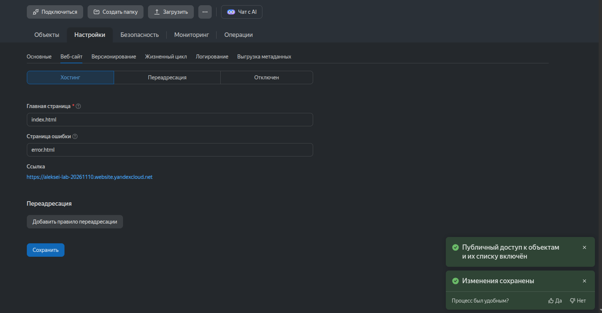
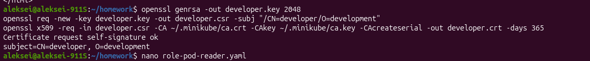
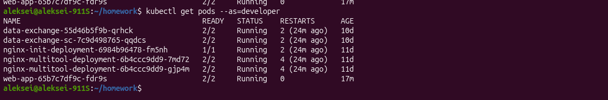

# Домашнее задание к занятию «Настройка приложений и управление доступом в Kubernetes

### Задание 1: Работа с ConfigMaps

### Задание 2: Настройка HTTPS с Secrets

### Задание 3: Настройка RBAC

